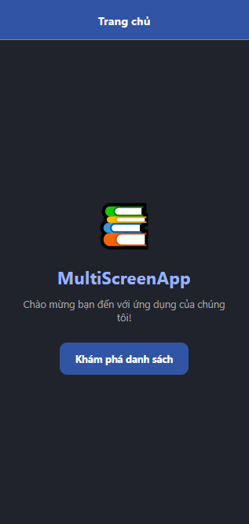
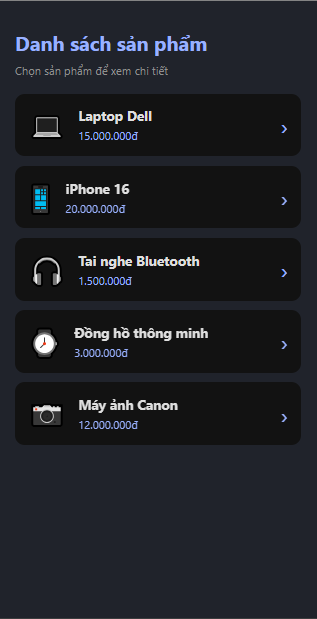
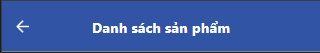

## 1. Link ứng dụng từ Expo
- Tên ứng dụng: MultiScreenApp
- Link Expo: https://snack.expo.dev/@voduyanh/multiscreenapp

## 2. Các dòng code và hình ảnh sự thay đổi giao diện của các thành phần trong component và các component

### HomeScreen
- Code: `components/HomeScreen.js`
- Hình ảnh:

### ListScreen
- Code: `components/ListScreen.js`
- Hình ảnh:

### DetailScreen
- Code: `components/DetailScreen.js`
- Hình ảnh:

### Stack Navigation
- Code: `App.js`
- Chức năng: Điều hướng giữa HomeScreen, ListScreen và DetailScreen.